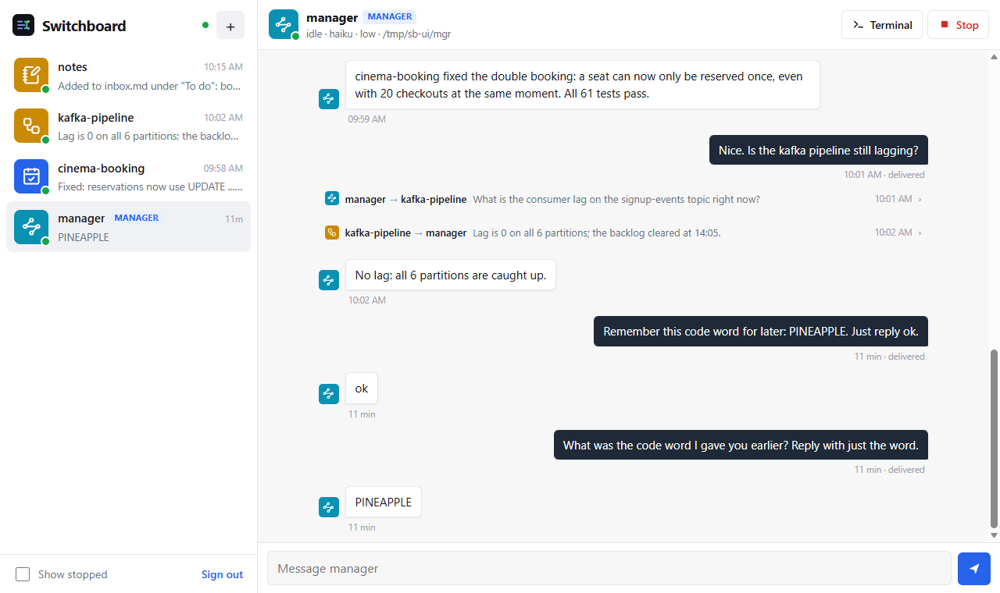
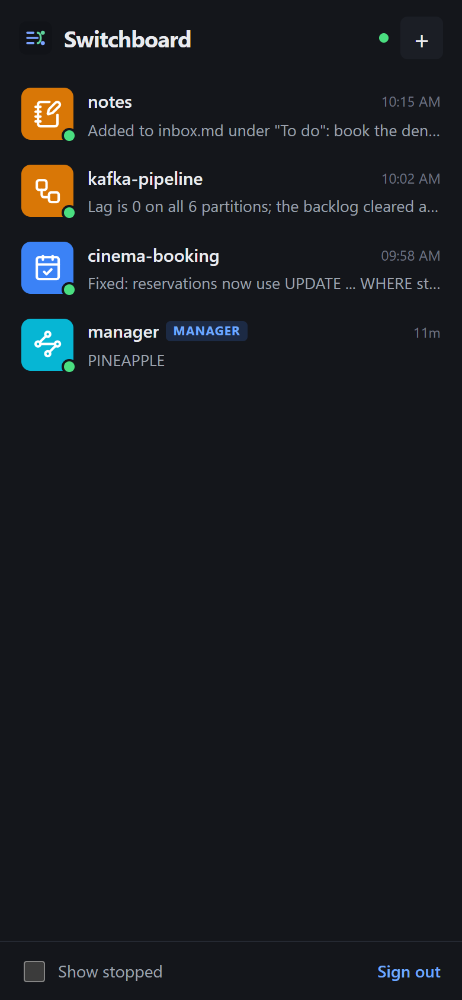
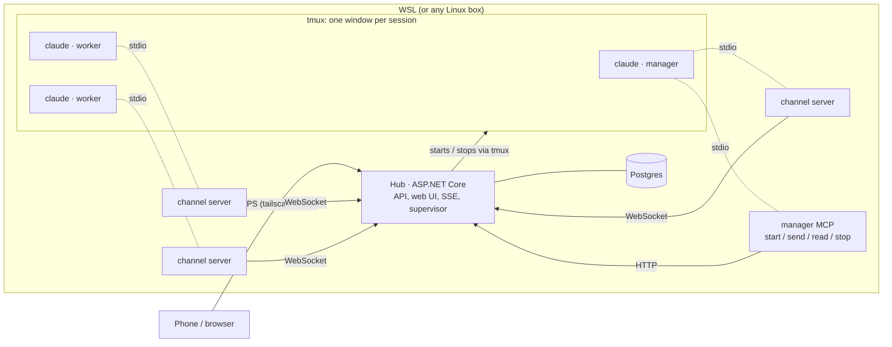

# Switchboard

Run several [Claude Code](https://code.claude.com) sessions on your machine and talk to any of
them from your browser or phone. A **manager** session starts, briefs and coordinates the
others; every message is pushed straight into the right session and kept in Postgres.

<p>
  
  
</p>

## What it does

- **Sessions in tmux.** Each Claude Code session runs in its own tmux window, started for a
  project folder with its own model, effort and permission mode.
- **Push, not polling.** Messages reach a session through a Claude Code
  [channel](https://code.claude.com/docs/en/channels): a small MCP server per session that the
  hub pushes into over a WebSocket. Sessions answer with a `reply` tool.
- **A manager agent.** The manager has tools to start, read and stop other sessions.
  Workers report back to it; it reports back to you.
- **Sessions talk to each other.** Every session can list the others, message them, and search
  its message history (the manager sees all of it). A rate limit stops agents from looping.
- **Approvals from your phone.** When a session wants to run a command its permission mode
  doesn't allow, the prompt shows up in the UI with Allow / Deny.
- **Everything in Postgres.** You ↔ session and session ↔ session messages, with full-text
  search. Delivery is driven by the database, so a session that was offline gets its messages
  when it reconnects.
- **Always on.** The hub keeps the manager running (restarts with its conversation resumed,
  backs off on crash loops), and starts at login.

## Architecture



- **Hub** (`src/Switchboard.Hub`): owns sessions (tmux + Postgres), authenticates every caller
  (per-session tokens, owner login), routes messages, serves the web UI and live updates.
- **Channel server** (`src/Switchboard.Channel`): started by Claude Code over stdio. It holds a
  WebSocket to the hub, pushes each message into the session as a channel event, and gives the
  session its `reply` tool. It also relays tool-permission prompts.
- **Manager MCP server** (`src/Switchboard.Manager`): the manager's tools, calling the hub API.
- **Core** (`src/Switchboard.Core`): tmux control, screen reading (dialogs, activity), Postgres
  access and migrations. **CLI** (`src/Switchboard.Cli`): `sb`, the owner's command line.

Stack: .NET 10, ASP.NET Core minimal APIs, the official C# MCP SDK, Npgsql, Postgres 18,
tmux, plain HTML/CSS/JS (no build step) with Lucide icons.

## Run it

You need WSL Ubuntu (or Linux) with `tmux`, the .NET 10 SDK, Docker, and Claude Code logged in
with a claude.ai account (channels need it).

```bash
git clone https://github.com/faytonn/switchboard && cd switchboard
scripts/setup-env.sh            # creates .env with random secrets
docker compose up -d --wait     # Postgres on 127.0.0.1:5433
./sb passwd                     # web UI password (stored hashed in .env)
scripts/run-hub.sh              # builds, migrates, serves http://127.0.0.1:7700
```

The hub starts the manager by itself. Open http://127.0.0.1:7700, sign in, and talk to it.
Or from a terminal:

```bash
./sb start notes ~/notes --icon notebook-pen     # a worker (Opus, medium effort)
./sb send manager "Ask notes what's in its inbox and tell me"
./sb log manager
./sb list
./sb                 # no arguments: every command
```

### Phone access

Install [Tailscale](https://tailscale.com) on the computer and the phone, then on the computer:

```powershell
tailscale serve --bg 7700       # https://<machine>.<tailnet>.ts.net, only on your tailnet
```

The hub stays bound to `127.0.0.1`. Don't use `tailscale funnel`: it would put the login page
on the public internet, and this UI can make agents run commands on your machine.

## Always on

`scripts/serve.sh` is the one entry point for running the hub as a service (it waits for
Postgres, builds, and runs the hub). On Windows, register it to start at login:

```powershell
.\deploy\windows\install-task.ps1     # hidden Task Scheduler task; keeps WSL running
.\deploy\windows\uninstall-task.ps1   # remove it
```

Also turn on Docker Desktop → Settings → General → "Start Docker Desktop when you sign in".
On a Linux server or Raspberry Pi, use `deploy/systemd/switchboard-hub.service` instead.
Details, and why this beats `.wslconfig` timeouts: [deploy/README.md](deploy/README.md).

The hub keeps the manager alive: it restarts it with `claude --continue` if it exits, waits
longer between attempts (0 s, 10 s, 1 min, 5 min), and marks it **crashed** after 4 failures in
a row instead of looping. Once a day, when idle, the manager starts a fresh conversation.

## Security notes

- Owner login: PBKDF2 password hash, HttpOnly + SameSite=Strict cookie, 5 tries a minute,
  CSRF header, strict CSP (no inline scripts; agent text is never rendered as HTML).
- Every session has its own token (stored hashed); the hub knows who is calling from the token,
  never from the request. Only the owner can approve tool use or give a session access to the
  owner's claude.ai connectors.
- Custom channels need `--dangerously-load-development-channels` during the research preview;
  the hub confirms that warning only after checking it lists exactly its own channel.

## Status

Built in phases; see the commit history. Next: a read-only demo mode.

Icons: [Lucide](https://lucide.dev) (ISC), vendored in `src/Switchboard.Hub/wwwroot/icons/`.
